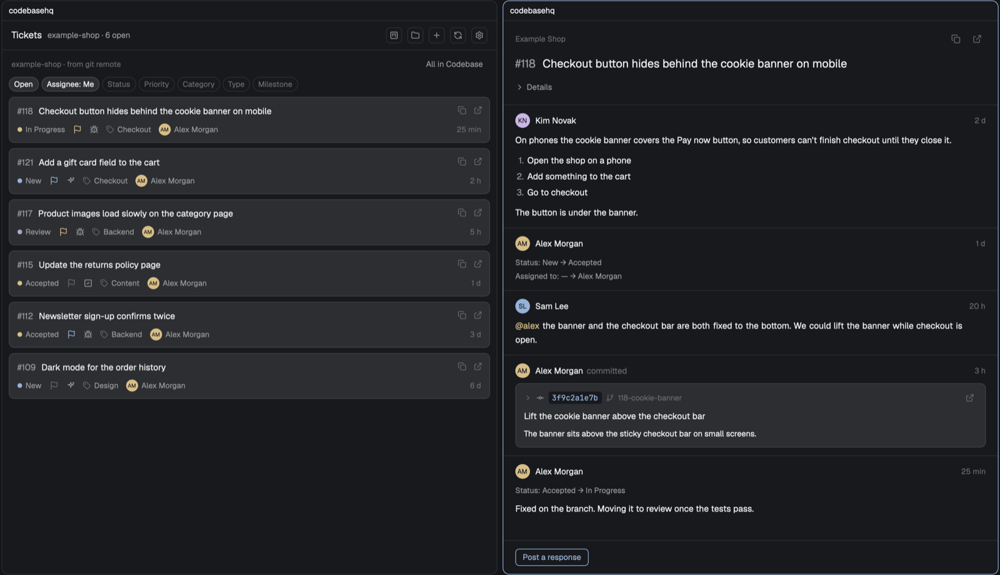
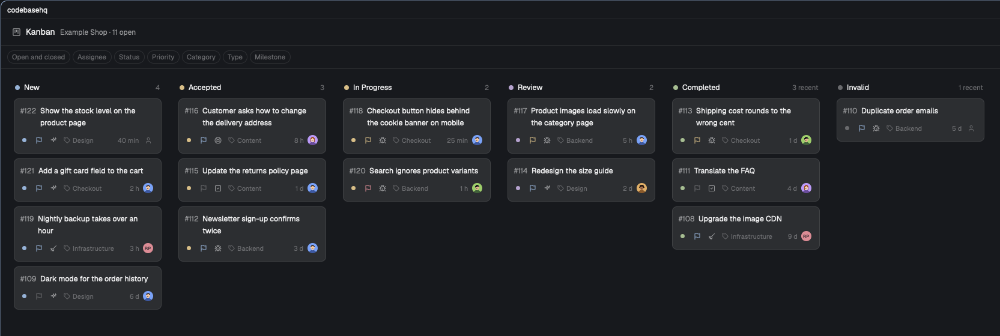

# CodebaseHQ for Herdr

A [Herdr](https://herdr.dev) mod for [Codebase HQ](https://www.codebasehq.com) tickets. It lists the tickets of the project you are working in (by default: yours, open) in the right-hand panel next to Files and Changes. You can open a whole ticket beside it, answer it, change its details, make new tickets, and work the project on a Kanban board.





*The screenshots show mock data: an invented shop, people and tickets, and drawn pictures for some of the people.*

- **Project from the git remote.** The focused terminal's repo decides the project
  (`git@codebasehq.com:<account>/<project>/<repo>.git`). The **folder** icon picks another project,
  or **All projects**, for that repo; the choice is remembered per repo. Outside a Codebase
  repo the default is **All projects**: every active project is asked (8 at a time) and the
  answers are merged, newest first, with the project's name on each card. Click the name to
  go to the space that works in that project (the list there then shows that project), or to open one in a local checkout of it
  (looked for in the default project folder, and in and next to your spaces' folders). Without
  one, it lists the project's repositories: pick one and a folder (the default project folder)
  and it is cloned there, with a progress bar. The
  Tickets panel shows in that space. It refreshes by
  itself every 10 minutes instead of every 2.
- **One card per ticket**, most recently updated first: number, summary and one
  row of details: status (name and colour), icons for priority (a flag in its colour) and
  type (Codebase's own icon; hover for the name), category with a tag, and the assignee.
  Age is on the right. The **copy icon** copies `#<id> <title>`, the **arrow icon** shows
  the ticket in the browser. The **reload** icon reloads (it also reloads every 2 minutes, and within
  20 seconds of a ticket changing elsewhere: by Claude, in Codebase's web UI).
- **Filter** with the buttons above the list: resolution (Open, Closed, Open and closed),
  Assignee (people, Me and Unassigned), Status, Priority, Category, Type and Milestone (finished
  milestones too, marked done).
  Pick several values in one filter; **Any** clears it, **Reset** goes back to the default
  `assignee:me resolution:open`. The filter is sent to Codebase as a search (e.g.
  `assignee:me status:"In Progress",New resolution:open`) and remembered per project. The list
  loads 60 tickets at a time; **Load more** at the bottom gets the next 60. It draws 60 cards at
  a time too (All projects can load hundreds): **Show more** draws the next 60.
- **Click a ticket's title** to see the whole ticket in a pane beside it: every field and
  every note (who, when, what changed, the text as Markdown, attachments). The fields are
  folded away; click the ticket's title in the pane to show them. Click status, priority, type, category,
  assignee or milestone there to change it, as on a card in the list. The arrow icon in its header
  scrolls to the latest note. Clicking another title shows that ticket in the same pane; clicking the shown one again closes it.
- **Commits.** Notes made by commits (`[touch:123]`) show as commits: the author, the short
  commit id, the branch and the message. Click a commit to see its diff right there, from a
  local clone (a checkout of that repository in one of your spaces' folders or next to them;
  a commit the clone lacks is fetched first). The API doesn't say which commit made a note, so
  the pane looks the message up in the project's repositories: the ticket's own branches
  (`123`, `123-…`, `ticket-123`), else `dev` and the default branch.
- **Images** in notes: click to see the image in the pane, scaled to fit; the arrow icon opens
  it in the browser. They are downloaded through the API (`/uploads/<id>`) once and kept in
  `~/.config/herdr-app/data/codebasehq-images/`.
- **Post a response** (the speech-bubble icon in the ticket pane's header) opens a form at
  the bottom: a note in Markdown, posted with
  **Post** or ⌘↩, with status, priority, type, category, assignee and milestone to change in
  the same note, as in Codebase's own form. Unsent text stays with its ticket.
- **New ticket** (the **+** icon): subject, description (Markdown), status, priority, type,
  category, assignee and milestone, filled in with the project's defaults. In All projects you
  pick the project first. The new ticket opens in the ticket pane.
- **Kanban** (the board icon, in a project) shows the project's tickets as a board in a pane
  zoomed to the whole work area: a column per status in the project's order, the closed ones
  last with only the 20 most recently updated. It has the list's filters (nothing picked by
  default). Drag a card to another column to change its status; it moves back if Codebase
  refuses. Click a card's title to open the ticket pane, its details to change them.
- **Changes** are saved as a Codebase note with changes, like in the web UI. The list, the
  board and the ticket pane reload each other after a change, a posted response included.
- **People** show with their Codebase picture (from Gravatar or Codebase) where they have
  one, else with their initials on a colour of their own.
- **Credentials** (API username `account/username` and API key, from My Profile →
  API Credentials in Codebase) are entered in the panel the first time and kept in the
  macOS keychain under the service `herdr-codebasehq`. Settings also has the **default project
  folder** (`~/Sites` unless you change it): where projects are cloned and checkouts looked for. Links in tickets open only if they are
  web (http/https) links.

The mod calls `https://api3.codebasehq.com` and runs `git`, `security` (macOS), `curl`,
`sips` and `shasum`. It is macOS only.

## Install

Tell your agent in Herdr:

```
Read ~/.config/herdr-app/AGENTS.md, then add this mod: github.com/sockiplastsmurfen/herdr-codebasehq
```

Or by hand:

```sh
cp -R mods/codebasehq ~/.config/herdr-app/mods/codebasehq
herdr-app check ~/.config/herdr-app/mods/codebasehq
```

Then add the panel to your layout's side-panel stack (`panel-body` in Herdr's layouts):

```json
{ "id": "codebasehq", "type": "block", "content": { "mod": "codebasehq" } }
```

and a button in your tab-bar mod (a clone of `tabs`), next to Files and Changes:

```js
.child(panelButton("codebasehq", "Tickets", "mods/codebasehq/ticket.svg"))
```

(plus `"codebasehq"` in its `enabled` list). Herdr's shipped layouts and mods are
read-only: clone them first (`herdr-app do layout.clone`, `mod.clone`).

[RECIPE.md](RECIPE.md) describes the mod for an agent that builds it from scratch.
