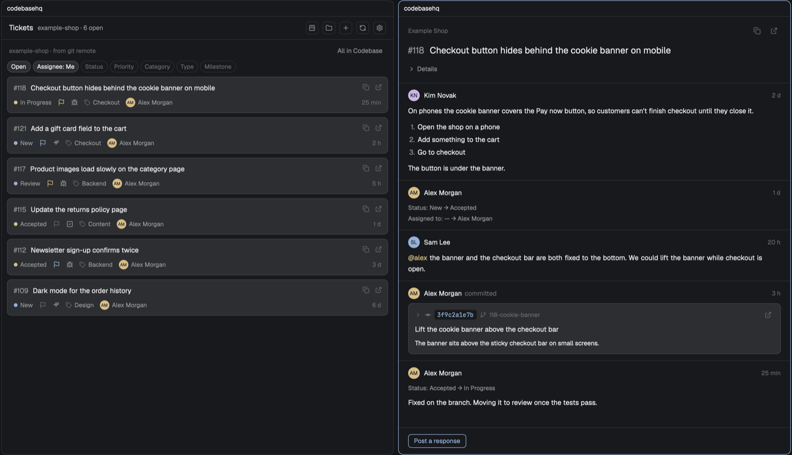

# CodebaseHQ

Your Codebase HQ tickets in Herdr. A panel beside Files and Changes lists the tickets of the project you are working in: yours and open by default, with filters. Click a ticket's title and the whole ticket opens in a pane beside it, with its details, every note and the commits that touched it. You can answer it there and change any detail. A Kanban board shows the project's tickets by status, and you drag a card to change its status. New tickets are made from the panel too. The project follows the focused terminal's git remote.

## What you see

- **The panel** (`mods/codebasehq`, a block in the layout's side panel), top to bottom:
  - **A header**, 44px high, with a 1px border under it. It has the title "Tickets" (14px, semibold), then the count (12px, `muted`: "6 open", with "+" when more can load). Then five framed icon buttons, each 24px with radius 6 and a 13px icon: Kanban board (only in a project), project picker (folder), New ticket (plus), Reload (spins while loading) and Settings (gear).
  - **A line under the header**: the project's name (12px semibold, from `/projects`, the permalink until that is in), then a link icon (22px, like the cards' Open) that opens the project's tickets in Codebase. Then, 11.5px `dim`, where the project comes from: "· from git remote", "· chosen for this repo" or "· default outside a repo". In All projects there is no icon.
  - **The filter bar**: pill buttons (22px high, radius 11, 11.5px) for resolution (Open / Closed / Open and closed), Assignee, Status, Priority, Category, Type and Milestone. An active one has a raised background and shows its value ("Assignee: Me", "Status: New +1"). "Reset" appears once the filter differs from the default `assignee:me resolution:open`. An open filter shows its values in a box under the bar (max 260px, scrolls) as checkboxes: square, round for resolution, accent when on. Assignee lists Me, Unassigned, then the people. Statuses carry their colour dot and a "closed" tag, and finished milestones a "done" tag.
  - **Cards**, one per ticket, newest update first. Each has a 10px side margin, 8px gap, radius 8, a 1px border on `raised`, and an accent border when it is the ticket shown in the ticket pane. In All projects the project name goes on top (11px, `dim`, accent on hover). Then `#id` (13px semibold `muted`) and the summary (13px, accent on hover), with Copy and Open icons on the right (22px, 13px icon). Under that is a row of chips:
    - status (7px dot in its colour and its name)
    - priority (a flag in its colour, icon only)
    - type (Codebase's icon mapped to ours, icon only)
    - category (a tag and the name)
    - assignee (picture or initials badge and the name)
    - the age on the right ("25 min", "5 h", "3 d", "2 mo")
  - **"Show more (N not shown)"** at the bottom when more is loaded than drawn: only 60 cards are drawn at a time, as All projects can load hundreds and drawing them all is too slow for a render. Then **"Load more"** when Codebase has more.
- **The ticket pane** (a pane beside the focused one):
  - A compact header: the project name (11.5px) with the pane's actions on the same row, 26px icons: Go to the latest note (arrow down to a line: scrolls the notes to the end through a `ScrollHandle` and an empty marker after the last note) and Post a response (speech bubble, highlighted while the form is open). Then the title row: a chevron, `#id` and the summary at 15px semibold (clicking them folds the details in and out), with the ticket's own actions at its right, as on a card in the list: Copy and Open.
  - **The details**, folded by default: clicking the title (chevron and all) unfolds them. Unfolded they show rows with a 96px label column: Status, Priority, Type, Category, Assigned to, Milestone (always, "None" when unset), Reported by and Created ("2026-11-11 09:16 · updated 7 d ago").
  - **The notes**, oldest first, each 18px in from the sides with a border between them:
    - The author's badge (22px) and name, and the age, with the full date on hover.
    - Field changes as "Status: New → Accepted" lines (11.5px, `muted`).
    - The text as Markdown (13px). A paragraph that @mentions someone is drawn word by word, with the name in that person's colour.
    - Images as boxes that unfold to the picture scaled to the pane. Other attachments as 📎 names. One the dialog can show (by its extension: PDF, Word, RTF, ODT, HTML, office files, images, text) opens the attachment dialog when clicked, with no icons after it. Any other (a zip) is saved in `~/Downloads` when clicked ("Saving…", then a toast), with a download icon after it that does the same. Without an upload id, the name opens the browser. An image box has a download icon too.
    - A note made by a commit shows as "<author> committed" and a box: chevron, commit icon, the short id in the mono font in an accent chip, a branch icon, the branch, an Open icon, then the message title and body. Unfolding it shows the diff, with file headings, + lines in green (`ansi2`), − lines in red (`ansi1`), hunks in cyan (`ansi6`) and 1500 lines at a time with "Show more".
  - **At the bottom**, while Post a response is open: a textarea (4–14 rows, Markdown), then chips for Status, Priority, Type, Category, Assigned to and Milestone (26px, radius 6, outlined in accent when changed), then Post, Cancel, "N details changed" and "⌘↩ posts".
- **The board pane** (a pane of its own, zoomed to the whole work area):
  - A 44px header with a board icon, "Kanban", and "Example Shop · 11 open".
  - The same filter bar, with nothing picked by default.
  - One column per status, 264px wide with radius 10, in the project's order with the closed statuses last. Each column header has a dot, the name and a count ("3 recent" for closed ones).
  - Cards with radius 8 and padding 10: `#id` and the summary (12.5px), then status, priority, type, category (grows), age and assignee.
- **The attachment dialog** (a Herdr dialog, 80% × 90% of the window; Esc or a click beside it closes it): a 44px header with a paperclip, the file's name (13px semibold), "N pages" or "first page" (dim), and 22px icons: Download, Quick Look (eye), Open in the browser, Close (×). Under it, on `background`, the pages as pictures, centered, 12px apart, at most the dialog's width (a small picture keeps its size), white behind document pages. A text file shows as text in the mono font (5000 lines). "Opening <name>…" while it is prepared.
- **Settings** (in the panel): API username (`account/username`), API key (masked), Codebase URL for links and Default project folder (`~/Sites` when empty), with Save and Forget credentials.

## How it behaves

- **The project** comes from the focused terminal's repo: `git rev-parse --show-toplevel`, then `git remote -v`, with origin first. Both `git@codebasehq.com:<account>/<project>/<repo>.git` and `https://<account>.codebasehq.com/<project>/<repo>.git` work. Focusing a pane without a folder (a mod) keeps what is shown. The folder button picks another project or **All projects** for this repo, remembered per repo. Outside a Codebase repo the default is All projects: every active project is asked, 8 at a time, and the answers are merged newest first.
- **Refresh**: every 2 minutes (every 10 minutes for All projects). Every 20 seconds the panel also asks for the project's most recently updated ticket, whatever the filter (`sort:updated_at order:desc`, page 1). When one is newer than last time, changed by Claude or in Codebase's web UI, the list reloads and says so in `shared("codebasehq.changed")` with the changed ids, so the board and the ticket pane reload too. Not in All projects. Switching back to a project reloads it if it is older than 1 minute. A page is 20 tickets. The list loads 3 pages at a time, and "Load more" gets 3 more.
- **Filters** are sent to Codebase as a search: `assignee:me status:"In Progress",New milestone:"Release 2.4" resolution:open sort:updated_at order:desc`. They are kept per project in localStorage. The board's filters are kept separately, also per project.
- **Changing a detail**: click a chip on a card, a chip on a board card, or a row in the ticket pane's details. The project's values open below it (statuses that close the ticket say "closes"). Picking one shows it at once and saves it as a Codebase note with `changes`. If Codebase refuses, it goes back and an error toast shows. A ticket closed while the list shows open tickets leaves the list, with a success toast.
- **Clicking a project name** (All projects) goes to the space that works in it (`space.select {id}`), and lets go of a project or All projects picked for that checkout before, so the list there shows the project: the first space with a terminal whose folder has a git remote in that project, else the first whose own folder does. Folders are looked up once. With no such space, it looks for a checkout of the project in the default project folder, and in and next to the local spaces' and terminals' folders (an origin in that project) and opens a space there (`space.new {folder}`). With none, the panel shows **Clone**: the project's git repositories (`/<project>/repositories`, picked like radio buttons, the only one picked already), a "Clone into" field (the default project folder from Settings) and "Clone and open". That runs `git clone -- <clone_url> <folder>/<repo>` without prompts (`ssh -o BatchMode=yes`, `GIT_TERMINAL_PROMPT=0`), refuses a folder that exists, and opens a space there. "Open without cloning" opens a space named after the project in the default project folder (`space.new {folder, name}`), with the list showing that project: outside a repo, a space can have a project of its own, kept as `space:<id>` among the chosen projects (and dropped when the space is gone); the source line says "chosen for this space". Switching to another space in the same folder reloads the list for that space's project. While it clones, a progress bar shows git's step ("Receiving objects 45%"), the size and speed, and the whole clone's share: git writes `--progress` to a log under `data/`, read every 250ms; the last line counts, as git redraws it with `\r`. Counting and compressing objects fill 0–8%, receiving 8–80%, resolving deltas 80–95% and checking out the rest. Once that space shows, it waits half a second (the tab bar puts back each space's own side panel on a switch) and then shows the list: `layout.select` of its block in its stack, and `layout.show` of the panel.
- **Start work** (branch icon on the ticket pane's title row) opens a form under the header (on `raised`): Branch (an input, `branchName`: the ticket number and the summary's words, accents dropped, lower case, at most 60 characters), In (the project's checkouts as chips: those the local terminals are in, the shown tab's first, by `git rev-parse` and the remote; then those found in the default project folder, which the panel shares as `shared("codebasehq.projectsDir")`), Ticket (what will change: a status whose name says it has started, "In Progress" and the like, and you as assignee if nobody is), Start and Cancel. Start runs, in the checkout: `git check-ref-format --branch`, `git fetch origin` (never asking: `GIT_TERMINAL_PROMPT=0`, ssh in batch mode), then `git switch` to the local branch, else `--track origin/<branch>`, else `-c <branch> <origin's default branch>`. Then the changes go as one note and a toast says which branch, where.
- **Clicking a title** opens the ticket pane beside the focused pane, or shows that ticket in the open one. Clicking the shown ticket's title again closes the pane. The pane follows `shared("codebasehq.open")`, checked every 300ms, and reloads its notes every minute.
- **Commits**: a note with no field changes is matched to a commit by its first line, with `[word:…]` references removed. The pane looks in the project's repositories: first the ticket's own branches (`123`, `123-…`, `ticket-123`), else `dev` and the default branch, up to 15 pages, back to 30 days before the oldest note. Clicking a commit runs `git show` in a local clone: a checkout whose origin is that repository, in a space's folder or a folder next to one. If the commit isn't there, it fetches the branch first. What was found is kept per ticket, so going back to a ticket looks up only notes that are new.
- **Images** in notes are downloaded once through the API (`/uploads/<id>`) into `<app home>/data/codebasehq-images/`, then shown at their size, at most the pane's width.
- **People** get their Codebase picture (Gravatar with `default=404`, or Codebase's own avatar at 64px), downloaded once into `data/codebasehq-images/avatars/`. Without one they get initials on a colour picked from their name (the theme's ANSI colours).
- **Post a response** posts the text and any changed details as one note. Text and picks not posted yet stay with their ticket while another is shown. Cancel throws them away; the header icon only folds the form away, keeping them.
- **New ticket** (plus) opens a form: Project (in All projects), Subject, Description, Status (first open one), Priority (the project's default), Type, Category, Assigned to (nobody) and Milestone (none). Create opens the new ticket in the ticket pane.
- **Kanban** (board icon) hides the side panel and opens the board pane zoomed. Clicking the icon again closes the board. Dragging a card works by mouse down, then 5px of movement: the card follows the pointer at 35% opacity where it was, and the column under the pointer lights up with "Move to <status>". Letting go there changes the status, with a move back if Codebase refuses. A card's title and chips don't start a drag.
- **Rendering**: Herdr renders on every focus, shared-state or theme change, and the board on every pointer move while a card is dragged. So parse once per load, not per render: a note's blocks and @mention pieces, a diff's rows, the board's columns, All projects' merged filter values. The board reuses the project's values (statuses, people…) for a minute.
- **Staying in step**: after a change (a detail, a posted response), the copy that made it writes `shared("codebasehq.changed")`. The list reloads, the board reloads, and the ticket pane reloads when it is that ticket. A reload asked for while the list is loading runs once that load is done.
- **Links** in notes open through `cx.open_url`, which takes http(s) only. Anything else shows "Only web links open from tickets".

## Built from

- `mods/codebasehq/`, `mod.json` `{ "place": "none", "title": "CodebaseHQ" }`. One mod in four roles:
  - no `props.view`: the panel list (`main.js`)
  - `props.view: "ticket"`: the ticket pane (`viewer.js`)
  - `props.view: "kanban"`: the board pane (`viewer.js` with `kanban.js`)
  - `props.view: "file"`: the attachment dialog (`fileview.js`), opened with `openOverlay({ kind: "dialog" })`
- **Files**:
  - `codebase.js`: the API, the keychain and git
  - `filters.js`: the shared filter bar
  - `panes.js`: opening and closing the ticket and board panes
  - `ui.js`: field marks, badges, links, the shared field change and value menu, and change announcements
  - `fileview.js`: the attachment dialog (`props.view: "file"`)
  - `startwork.js`: Start work, in the ticket pane
  - SVG icons in the folder and in `icons/`
- **API**: Codebase API v3 at `https://api3.codebasehq.com`, JSON, with Basic auth `account/username:key`.
  - `/<project>/tickets?query=…&page=`
  - `/<project>/tickets/<id>` and `/<project>/tickets/<id>/notes`, where POST takes `{ ticket_note: { content, changes } }`
  - `/<project>/tickets/{statuses,priorities,types,categories}`, `/<project>/assignments` and `/<project>/milestones`
  - `/projects`, `/users`, `/<project>/repositories`, `/<project>/<repo>/branches`, `/<project>/<repo>/commits/<branch>?page=`
  - `/uploads/<id>`
  - POST `/<project>/tickets` for a new ticket
- **`herdr` functions**: `exec`, `focused`, `spaces`, `panes`, `run` (`pane.split`, `pane.close`, `pane.zoom`, `layout.hide`), `shared`/`setShared`, `notify`, `appHome`, `layout`, `settings`, `theme`, `props`, `checking`.
- **Programs**: `git`, `security` (the macOS keychain, service `herdr-codebasehq`), `curl` (images, pictures and attachments), `sips` (image size), `osascript` (PDFKit and the text system, to draw attachments' pages), `qlmanage` (Quick Look), `shasum`, `/bin/sh`.
- **In the layout**: a block `{ "id": "codebasehq", "type": "block", "content": { "mod": "codebasehq" } }` in the side panel's stack, and a panel button in the tab bar.

## Watch out

- **Ticket type**: a change to the type is `ticket_type_id`. `type_id` is ignored.
- **Statuses** say they close a ticket with `treat_as_closed`, which some answers spell `treat-as-closed`.
- **Unassigned** is `assignee:none`, but Codebase drops it from a list of values (`assignee:me,none` finds only yours). As a term of its own it is ORed with the other assignees and ANDed with the rest: `assignee:none assignee:me status:New`.
- **`/users`** also returns other people's API keys. Keep only names, ids and picture URLs.
- **Commit notes**: the API gives a note made by a commit only its message, with no commit id and no repository. Matching by message is the only way.
- **Images**: Codebase serves note images (`/upload/<id>/show/original`) only to a logged-in browser, but the API serves the same file at `/uploads/<id>`. `fetch()` reads text only, so `curl` downloads it. Pass the key to curl on stdin through a config file (`-K -`), escaped, never on its command line.
- **Attachments**: Herdr draws pictures and text, not PDFs or Word files. Download the file the way images are (`/uploads/<id>`) into `data/codebasehq-files/<id>/<name>`, the name kept (the tools go by its extension) but made safe for a path: letters and digits of any script and ` ._()+,-` only, no leading dot or dash. Then turn it into pictures with macOS's own tools, through `osascript -l JavaScript` (JavaScript for Automation, which reaches PDFKit and AppKit):
  - a PDF: PDFKit draws each page (at most 60, 1400px wide) to `pages/<n>.png`;
  - Word, RTF, ODT, HTML: `NSAttributedString` reads it and `NSPrintOperation` lays it out on A4 pages as a PDF (not centered on the page), then as a PDF;
  - anything else (Excel, PowerPoint, Pages, Numbers…): `qlmanage -t` makes a picture of its first page;
  - images as they are, text files as text.
  Quick Look (`qlmanage -p`) runs in the background (`&`), so its window stays after the exec returns. Download copies the file to `~/Downloads`, adding " (2)" and so on when the name is taken, and an image's format as extension when its name has none.
- **Pictures**: Codebase's picture for someone without one is a grey silhouette. Treat that file (by its SHA-256) as no picture, so initials show instead.
- **A space's `folder`** is only where its new terminals start, and can be another project's folder. Its terminals' folders (`panes()[].cwd`) say where it works.
- **Panes**: `panes()` names only the mod, so `shared("codebasehq.panes")` remembers which pane is the ticket pane and which is the board. A zoomed tab can't be split: unzoom first.
- **Drag and drop**: GPUI-kit has none for your own elements. Build it from mouse down, move and up on the board.
- **Unchecked API names**: `milestone_id` (as a change and on create) and the `milestone:` search keyword haven't been tried against Codebase. A milestone counts as finished when its status contains "complete" or "cancel".
- **Cloning**: the clone URL comes from the API and goes on git's command line: check that it is `git@…`, `ssh://…` or `https://…` and pass it after `--`. git can't ask for a password or a host key from a mod, so make it fail instead of hang.
- **macOS only**: the keychain is reached through `security`, and the panel has nothing else to keep the key in.

## Done when

- `herdr-app check mods/codebasehq` passes.
- In a Codebase repo, the panel shows that project's open tickets assigned to you. Changing a filter changes the list.
- Clicking a title opens the ticket pane with all its notes. A commit note shows as a commit, and its diff opens from a local clone.
- Changing a status on a card, on the board or in the ticket pane's details shows up in Codebase as a note with that change.
- Posting a response adds the note in Codebase and in the pane.
- Dragging a board card to another column changes its status.
- A link in a note that isn't http(s) doesn't open.
- Start work on an unassigned New ticket switches a checkout to `<id>-
` and makes the ticket In Progress and yours.
